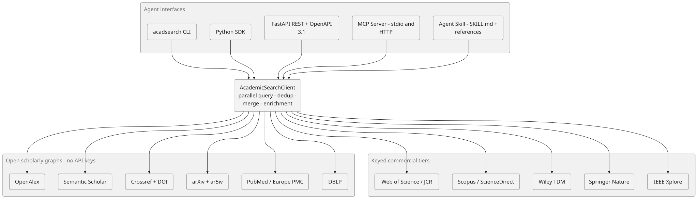
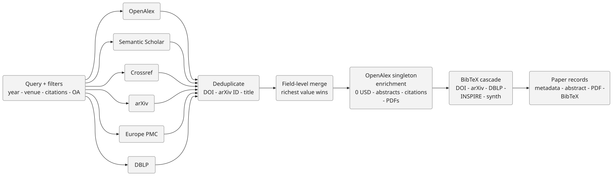
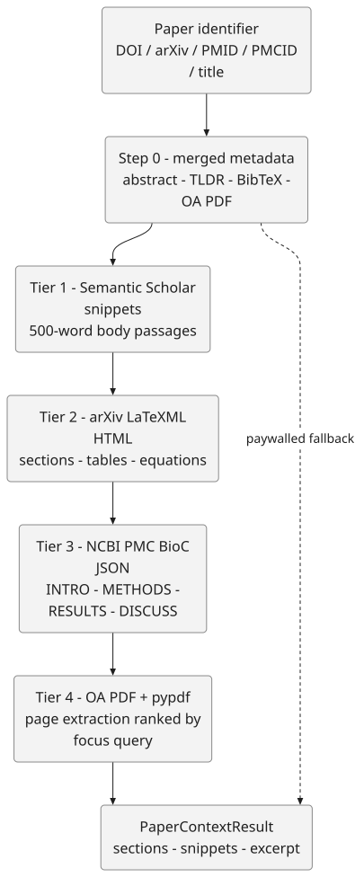

# `acadsearch` — Unified Academic Search Database API, SDK, CLI, MCP Server & Agent Skill

`acadsearch` is an agent-first scholarly search and retrieval suite that unifies **24+ academic paper and journal databases** behind a single Python SDK, Command-Line Interface (CLI), OpenAPI 3.1 REST server, Model Context Protocol (MCP) server, and drop-in Agent Skill (`skills/academic-search/SKILL.md`).

It works **out of the box with zero API keys required** across open scholarly graphs and repositories (OpenAlex, Semantic Scholar, Crossref, arXiv, PubMed/Europe PMC, NCBI PMC BioC, PubTator 3.0, DOAJ, DBLP, INSPIRE-HEP, Unpaywall, OpenCitations) while supporting optional API keys for commercial and rate-boosted tiers (Elsevier Scopus/Serial Title, CORE, Springer Nature, IEEE Xplore, Web of Science, NASA ADS, Consensus, scite, Elicit).

---

## Architecture

Every agent interface — CLI, SDK, REST, MCP server, and Agent Skill — funnels into a single `AcademicSearchClient` that fans queries out across open scholarly graphs and optional keyed commercial tiers, then deduplicates, merges, and enriches the results.

<p align="center">
  
</p>

### Paper search pipeline

A query fans out in parallel to every selected provider, deduplicates matches by DOI / arXiv ID / title fingerprint, merges records field-by-field, enriches top results through OpenAlex's free singleton endpoint, and resolves canonical BibTeX before returning the final records.

<p align="center">
  
</p>

---

## Key Capabilities

1. **Multi-Database Paper Search & Deduplication (`search_papers`)**:
   - Parallel search across OpenAlex, Semantic Scholar, Crossref, arXiv, PubMed/Europe PMC, DBLP, DOAJ, INSPIRE-HEP, and CORE.
   - Automatic cross-provider deduplication by normalized DOI, arXiv ID, and title fingerprint.
   - **Zero-Cost OpenAlex Singleton Enrichment**: Even if the shared keyless IP search quota on OpenAlex (`$0.10/day`) is exhausted, `acadsearch` automatically enriches matched DOIs and arXiv IDs (`10.48550/arXiv.{id}`) via OpenAlex's **free (`$0.00`) singleton endpoint** (`/works/https://doi.org/{doi}`), recovering citation counts, OpenAlex IDs, topics, OA PDF URLs, and reconstructed inverted-index abstracts.
2. **Journal & Venue Search with Impact Metrics (`search_journals`)**:
   - Queries OpenAlex `/sources`, DOAJ `/v4/search/journals`, Crossref `/v1/journals`, and DBLP `/search/venue/api`.
   - Returns ISSNs (`issn_l` + print/electronic ISSNs), publisher, Gold/Diamond Open Access & DOAJ status, APC fees in USD, `h_index`, `i10_index`, and **`two_year_mean_citedness`** (the open equivalent of 2-year Journal Impact Factor), plus optional Elsevier `CiteScore`, `SJR`, and `SNIP`.
3. **Multi-Tier Canonical BibTeX Resolver (`get_bibtex`)**:
   - Cascades through: (1) Universal DOI content negotiation (`https://doi.org/{doi}` with `Accept: application/x-bibtex`), (2) official arXiv BibTeX (`https://arxiv.org/bibtex/{id}`), (3) official DBLP `.bib` (`https://dblp.org/rec/{key}.bib?param=0` with automatic Anubis `v1.27.0` `metarefresh` challenge resolution), (4) INSPIRE-HEP `?format=bibtex`, (5) Semantic Scholar `citationStyles.bibtex`, and (6) deterministic BibTeX synthesis from merged metadata.
4. **4-Tier Full-Text & PDF Context Extractor (`get_pdf_context`)**:
   - Designed to give AI agents deep section-level context (Introduction, Methods, Results, Discussion, equations, tables) without dumping 30,000 raw PDF tokens into the prompt:
     - **Tier 1**: Semantic Scholar `/graph/v1/snippet/search` (~500-word body-text snippets ranked by `focus_query`).
     - **Tier 2**: Native arXiv LaTeXML HTML (`https://arxiv.org/html/{id}`) and `ar5iv` (`https://ar5iv.labs.arxiv.org/html/{id}`) section & equation extraction.
     - **Tier 3**: NCBI PMC BioC Full-Text JSON (`pmcoa.cgi/BioC_json/{id}/unicode`) and PubTator 3.0 full-text BioC JSON (`publications/export/biocjson?pmids={pmid}&full=true`) for structured biomedical sections (`INTRO`, `METHODS`, `RESULTS`, `DISCUSS`, `TABLE`, `FIG`).
     - **Tier 4**: Legal Open-Access PDF resolution (via OpenAlex, Semantic Scholar, Europe PMC, and Unpaywall) + `pypdf` page extraction ranked by `focus_query`.
5. **Citation Graph Traversal (`get_citations`)**:
   - Retrieves incoming citing papers and outgoing references via OpenAlex and OpenCitations Index v2 (`COCI`).

### The 4-tier full-text context cascade

`get_pdf_context` gives agents deep section-level context without flooding the prompt window, cascading from targeted body-text snippets through structured HTML and BioC JSON to legal OA PDF extraction — with a paywalled fallback to abstract + snippets.

<p align="center">
  
</p>

---

## Installation

```bash
pip install -e .
```

---

## 1. Command-Line Interface (`acadsearch`)

```bash
# Search papers (JSON, Markdown, or BibTeX output)
acadsearch papers "Attention Is All You Need" --limit 3 --format markdown
acadsearch papers "Retrieval-Augmented Generation" --year-min 2024 --oa --limit 5 --format json
acadsearch papers "3D Gaussian Splatting" --limit 5 --format bibtex > refs.bib

# Search journals and impact metrics
acadsearch journals "Nature Machine Intelligence" --limit 2 --format markdown
acadsearch journals --issn "1476-4687" --format json
acadsearch journals "PLOS ONE" --oa --limit 2 --format markdown

# Lookup single paper by DOI, arXiv ID, PMID, PMCID, OpenAlex ID, or title
acadsearch paper "arXiv:1706.03762" --format markdown
acadsearch paper "10.1038/nature14539" --format json

# Resolve BibTeX directly
acadsearch bibtex "10.1038/nature14539"
acadsearch bibtex "arXiv:1706.03762"

# Extract full-text & PDF context (sections, snippets, abstract, BibTeX)
acadsearch context "arXiv:2402.01680" --query "multi-agent architecture communication" --format markdown
acadsearch context "PMID:29355051" --query "immunotoxicity antitumor" --format markdown

# Traverse citations & references
acadsearch citations "arXiv:1706.03762" --direction citing --limit 5

# List all 24+ supported academic databases
acadsearch databases
```

---

## 2. Model Context Protocol (MCP) Server

### Stdio Transport (Claude Code, Cursor, Claude Desktop, Codex)
```bash
claude mcp add acadsearch -- python3 -m acadsearch.mcp_server
```
Or add `mcp_config.example.json` to your MCP client configuration.

### Streamable HTTP Transport
Run `acadsearch serve --port 8000` and connect your HTTP MCP client to `POST http://localhost:8000/mcp`.

### Exposed MCP Tools (7 Tools)
- `academic_search_papers`
- `academic_search_journals`
- `academic_get_paper`
- `academic_get_bibtex`
- `academic_get_pdf_context`
- `academic_get_citations`
- `academic_list_databases`

---

## 3. HTTP REST API & OpenAPI 3.1 Specification

Start the FastAPI server:
```bash
acadsearch serve --host 0.0.0.0 --port 8000
```
- Interactive Swagger UI: `http://localhost:8000/docs`
- OpenAPI 3.1 Spec: `openapi.json` (pre-exported in repository root)
- Endpoints:
  - `GET /health`
  - `GET /v1/databases`
  - `GET /v1/papers/search?q=...&year_min=...&open_access_only=...&sort=...`
  - `POST /v1/papers/search`
  - `GET /v1/papers/lookup?id=...`
  - `GET /v1/journals/search?q=...&issn=...&open_access_only=...`
  - `GET /v1/bibtex?id=...`
  - `GET /v1/context?id=...&focus_query=...&max_chars=...`
  - `GET /v1/citations?id=...&direction=...&limit=...`
  - `POST /mcp` (Streamable HTTP JSON-RPC 2.0 MCP endpoint)

---

## 4. Agent Skill Package (`skills/academic-search/`)

Copy `skills/academic-search/` into your agent's skills directory (e.g., `.claude/skills/academic-search/` or `~/.codex/skills/academic-search/`):
- `skills/academic-search/SKILL.md`: Main skill routing instructions, CLI/SDK/MCP commands, and guardrails.
- `skills/academic-search/references/open-scholarly-graphs.md`: OpenAlex, Semantic Scholar, Crossref, OpenCitations, DataCite, OpenAIRE, ORCID.
- `skills/academic-search/references/journals-oa-bibtex.md`: DOAJ v4, Unpaywall v2, Universal DOI Content Negotiation (`doi.org`), CORE v3, HAL, Zenodo.
- `skills/academic-search/references/discipline-databases.md`: arXiv + ar5iv/HTML, PubMed E-utilities, Europe PMC, NCBI PMC BioC JSON, PubTator 3.0, bioRxiv/medRxiv, DBLP, INSPIRE-HEP, NASA ADS.
- `skills/academic-search/references/publisher-and-ai-apis.md`: Elsevier Scopus/ScienceDirect/Serial Title, Springer Nature, IEEE Xplore, Clarivate Web of Science/JCR, Dimensions, The Lens, Google Scholar, Consensus MCP, scite MCP, Elicit v2, FutureHouse PaperQA2.
- `skills/academic-search/references/fulltext-pdf-context.md`: 4-Tier Full-Text & PDF Context Extraction Pipeline.
